<div align="center">

<picture>
  <source media="(prefers-color-scheme: dark)" srcset="docs/art/banner-dark-en.svg">
  
</picture>

[](https://github.com/Sweax3169/sweaxnext/releases/latest)
[](#install)
[](#16-styles)
[](LICENSE)

[Website](https://sweax3169.github.io/sweaxnext/) · [Türkçe](README.tr.md) · [Download](https://github.com/Sweax3169/sweaxnext/releases/latest) · [Hear the demo](https://sweax3169.github.io/sweaxnext/#listen)

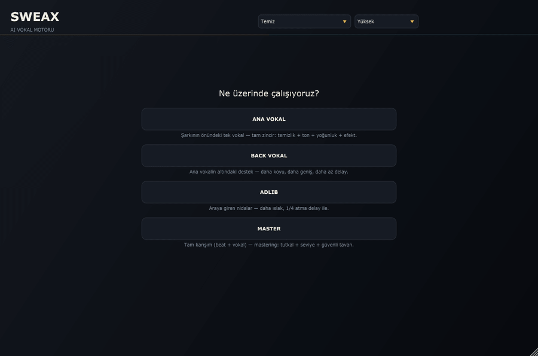

<sub>Rendered by the plug-in itself, off-screen, while the demo take plays through it.</sub>

</div>

## What it is

SweaxNext is a VST3 plug-in for rap vocals. Put it on the vocal channel, say what the track is (lead, backing, ad-lib
or the whole master), press **VOKALİ ANALİZ ET** and play the verse. It listens, measures every phrase and names what
is wrong: mic pops, harsh esses, room noise, mains hum, lines recorded at different levels, a boxy or muddy tone.
Then it builds a chain for the style you picked, renders that chain offline on what it heard, measures again and
adjusts. When it is done, every decision sits in ordinary parameters that you can read, change, automate and undo.

It does only what the take needs. A module with no evidence stays off and its card says so (**GEREKMEDİ**,
*not needed*). The interface is in Turkish; this page translates every label you will meet.

## Hear it

The demo vocal is a synthetic voice (Piper TTS, CC0 voice) reading lines written for this repository, then made
worse on purpose: a boxy room, a short reflection, fan noise, 50 Hz hum, mic pops on *p* and *b*, harsh esses around
7 kHz and lines recorded up to 13 dB apart. Every processed version below is the unedited output of `SweaxRender`,
the plug-in's own offline renderer, with the lead-vocal role. Nothing was touched by hand.

<p align="center">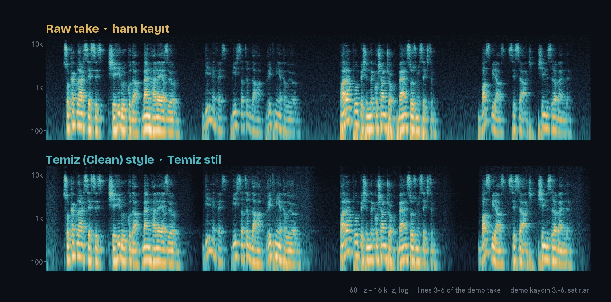</p>

**Listen:** [raw take](docs/audio/ham.mp3) · [Doğal](docs/audio/dogal.mp3) · [Temiz](docs/audio/temiz.mp3) ·
[Trap](docs/audio/trap.mp3) · [Agresif](docs/audio/agresif.mp3) · [Ezhel style](docs/audio/ezhel.mp3) ·
[Killoki style](docs/audio/killoki.mp3) · [Motive style](docs/audio/motive.mp3) · [beat](docs/audio/beat.mp3) ·
or switch between all 16 live on the [website](https://sweax3169.github.io/sweaxnext/#listen), with A/B, matched
loudness and the beat under it.

What changed on the full 58-second take with the **Temiz** (Clean) style:

| Measured | Raw take | After SweaxNext | How it was measured |
|---|---:|---:|---|
| Loudness | −22.9 LUFS | −19.4 LUFS | integrated, ITU-R BS.1770, plug-in's own report |
| Noise floor | −54.6 dBFS | −67.2 dBFS | plug-in's own report |
| Signal to noise | 32.3 dB | 47.5 dB | plug-in's own report |
| Noise between lines | −54.3 dBFS | −56.9 dBFS | median RMS of the gaps between the 16 lines |
| Loudest line vs quietest | 12.4 dB | 3.6 dB | RMS of each line above 100 Hz |
| Low thump (pops) | 15.2 dB | 9.5 dB | loudest 20 ms of 20–120 Hz, against the vocal body |
| Harsh s peaks | 10.7 dB | 5.9 dB | 99th percentile of 5–10 kHz, against the vocal body |
| Plosives found | 7 | 0 | plug-in's own detector |

<sub>The same numbers for every style are in [`docs/audio/demo.json`](docs/audio/demo.json). Rebuild them with
`Tools/demo/demo_uret.py`, `render_hepsi.py` and `yayin_hazirla.py`.</sub>

## What it does

<table>
<tr>
<td width="50%"><picture><source media="(prefers-color-scheme: dark)" srcset="docs/art/card-listen-dark-en.svg"></picture></td>
<td width="50%"><picture><source media="(prefers-color-scheme: dark)" srcset="docs/art/card-diagnose-dark-en.svg"></picture></td>
</tr>
<tr>
<td width="50%"><picture><source media="(prefers-color-scheme: dark)" srcset="docs/art/card-verify-dark-en.svg"></picture></td>
<td width="50%"><picture><source media="(prefers-color-scheme: dark)" srcset="docs/art/card-styles-dark-en.svg"></picture></td>
</tr>
<tr>
<td width="50%"><picture><source media="(prefers-color-scheme: dark)" srcset="docs/art/card-ab-dark-en.svg"></picture></td>
<td width="50%"><picture><source media="(prefers-color-scheme: dark)" srcset="docs/art/card-realtime-dark-en.svg"></picture></td>
</tr>
</table>

- **Listens first.** While you play the take it captures the vocal on a background thread and analyses it phrase by
  phrase: voice activity, pitch, loudness, true peak and the spectrum of every frame. The screen shows what it has
  heard so far and how sure it is. Longer takes mean more confidence; with little evidence it does less.
- **Names the problem.** 22 checks, each with a probability, a severity and a confidence: clipping, low level, DC
  offset, noise floor, hum, hiss, low-frequency noise, boom, proximity, mud, box, nasal, harsh, dull, bright, thin,
  resonances, level jumps between phrases, uneven syllables, over-compression, sibilance and plosives.
- **Checks its own work.** The plan is rendered offline on the captured take and measured again. If the result
  misses the target it adjusts and tries again, up to three rounds, and keeps the best one.
- **16 styles.** Each style is a whole recipe: the order of the insert modules and where every module starts. The
  analysis still decides how hard each one works on your take.
- **Level-matched A/B.** **ORİJİNAL** plays your dry take delayed and level-matched to the processed one
  (**A/B EŞİT SES**), so louder never fools you. **DELTA** plays only what the plug-in added or removed.
- **Real time.** Latency depends only on the quality mode and is reported to the host. Use **Canlı** (Live) while
  recording and **Yüksek** (High) for the mix.

## The screen

| | |
|---|---|
| 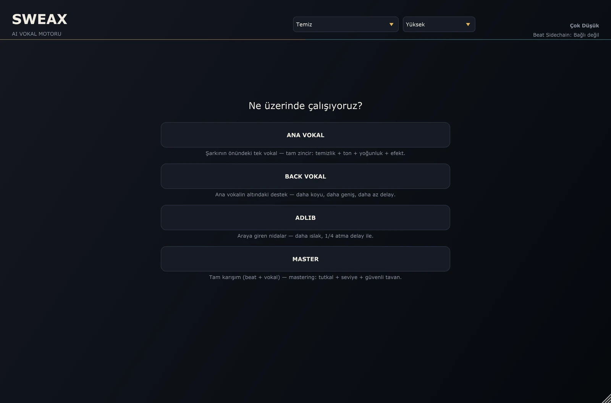 | 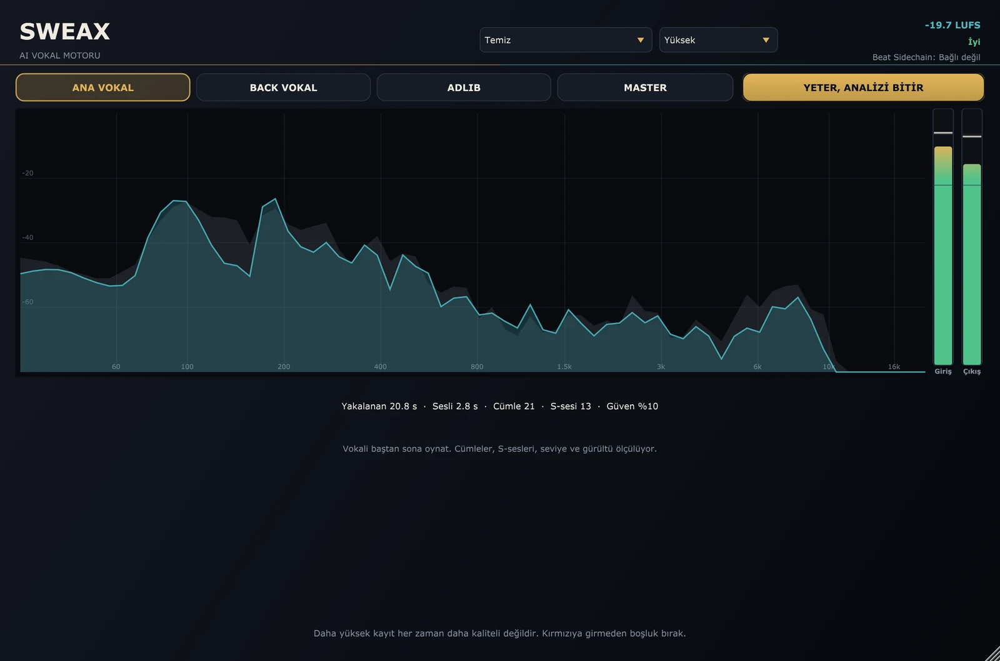 |
| **Role select.** *ANA VOKAL* (lead), *BACK VOKAL*, *ADLIB* or *MASTER*. | **Listening.** Phrases, s-sounds and pops are counted as you play; the confidence rises. |
| 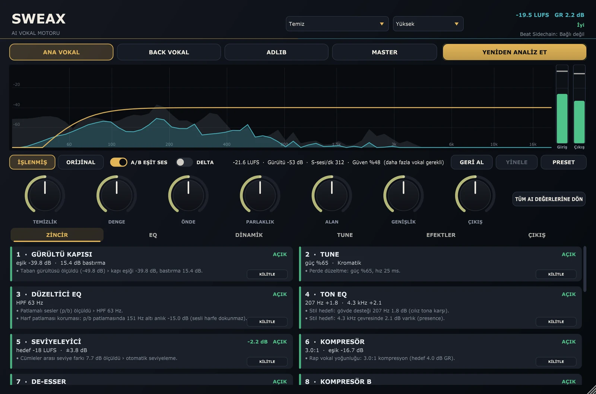 | 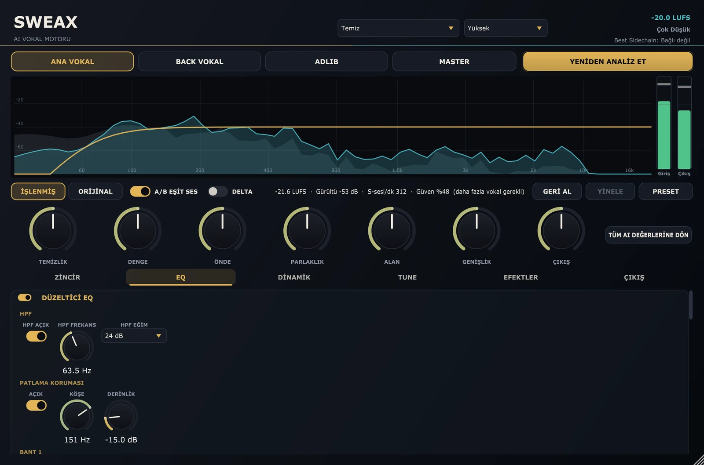 |
| **ZİNCİR** (chain). The cards in processing order, each with what it did and why. Lock a card (**KİLİTLE**) to keep your settings when you analyse again, or force a module on (**YİNE DE AÇ**). | **EQ.** High-pass, a plosive guard that acts before the filter, six bands that can each turn dynamic, and the style's tone EQ. |
| 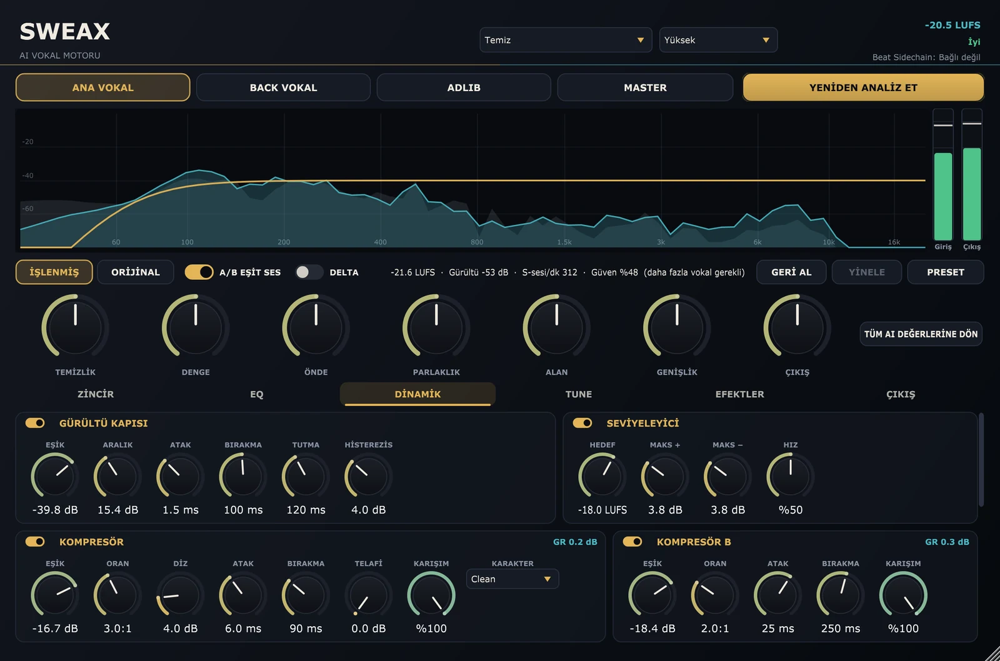 | 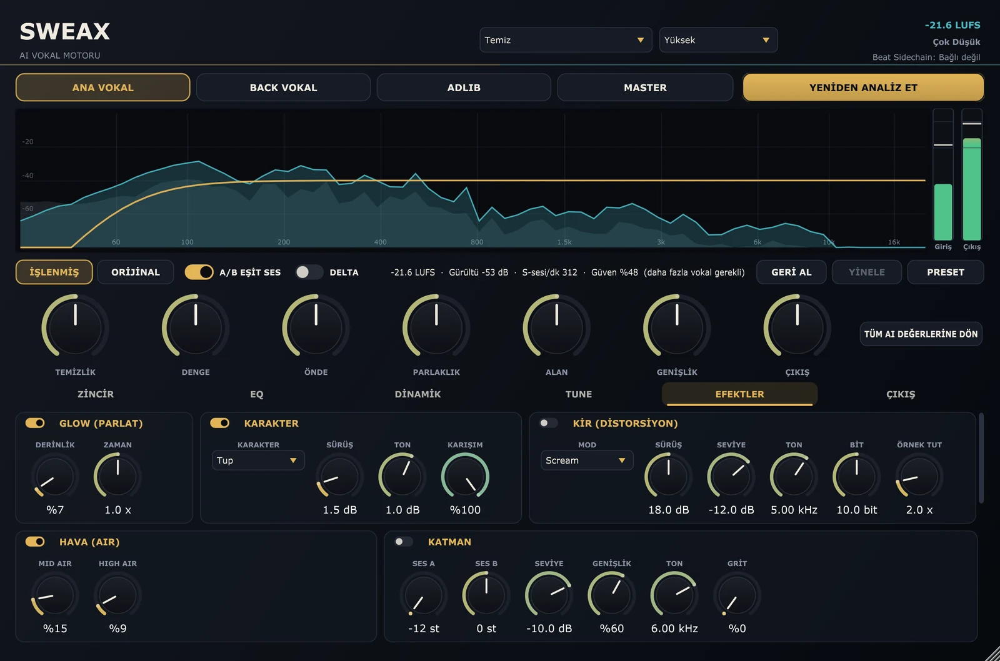 |
| **DİNAMİK** (dynamics). Gate, leveler, two compressors, the de-esser with its final s-guard, and *YUMUŞAT* (Smooth) for resonances that ring for a moment. | **EFEKTLER** (effects). Glow, character saturation, dirt, air, octave layer, doubler, delay, reverb and width. |
| 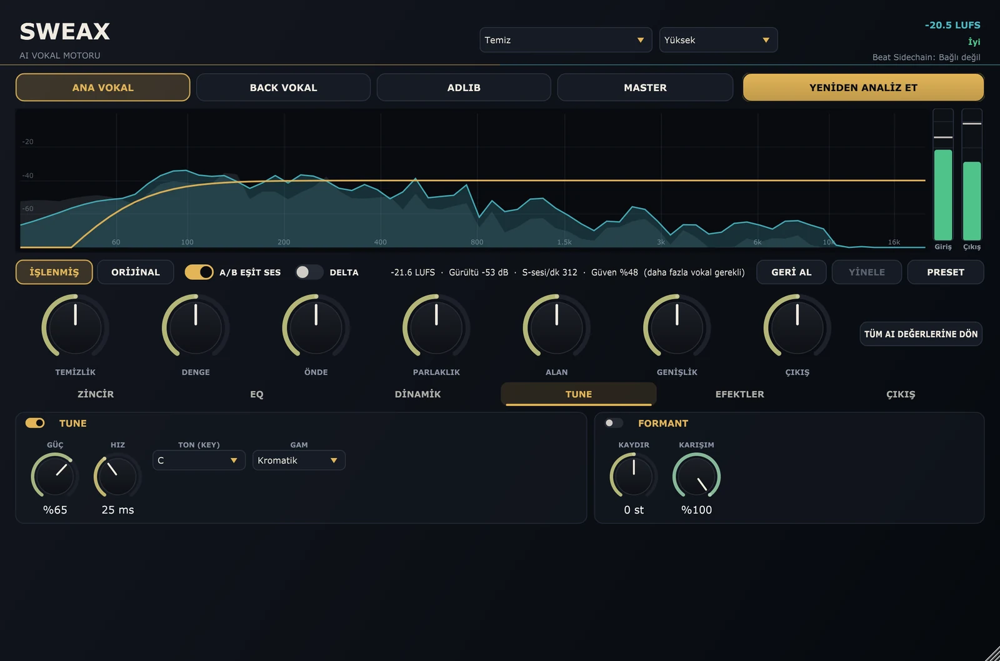 | 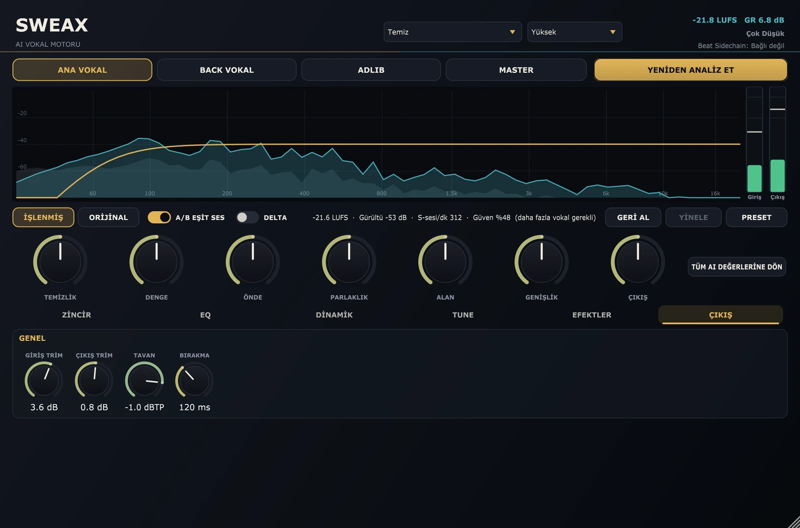 |
| **TUNE.** Pitch correction that locks to the key when it can tell the key, and a formant shift that leaves the pitch alone. | **ÇIKIŞ** (output). Input and output trim, true-peak ceiling and limiter release. |

The seven macros under the spectrum turn many parameters at once: **TEMİZLİK** (clean-up), **DENGE** (balance),
**ÖNDE** (upfront), **PARLAKLIK** (brightness), **ALAN** (space), **GENİŞLİK** (width) and **ÇIKIŞ** (output).
**TÜM AI DEĞERLERİNE DÖN** puts everything back to what the analysis chose.

## 16 styles

<p align="center">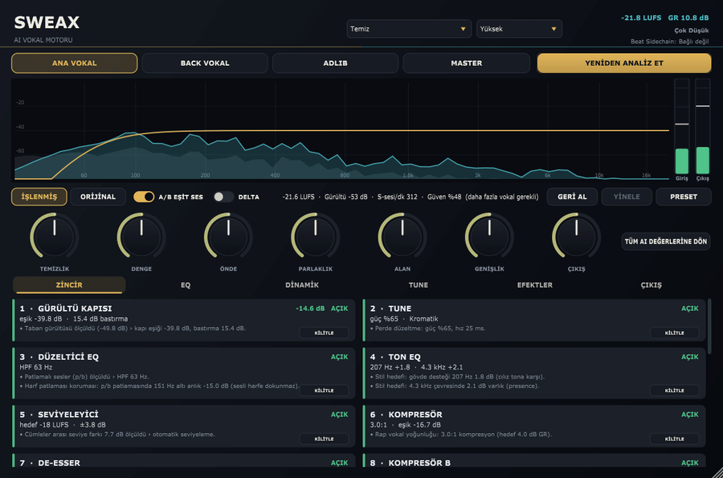</p>

Pick a style in the box at the top. On a finished mix the new plan is applied at once, without listening again.

| Style | What the recipe does |
|---|---|
| **Doğal** | Light touch: no tune, gentle 2.5:1 compression, no doubler or delay, a little plate. |
| **Temiz** | Clear and forward: presence and air lift, soft tune, light doubler, short slap and plate. |
| **Trap** | Hard tune (4 ms), 4:1 compression, saturation and glow, two-voice doubler, a little wider. |
| **Agresif** | Heavy 4:1 compression and drive, doubled, short reverb. |
| **Killoki style** | Rage: 8:1 punch compression, broken saturation and fuzz dirt, octave-up layer, dark top, dotted-eighth delay into a hall. |
| **Reçkol style** | Bright and full: body and air lift, tape saturation, formant down 1.6 semitones, wide two-voice doubler, chamber. |
| **Ati242 style** | Dark and warm: lift at 165 Hz, dark top, soft-knee compression into an opto, faint scream dirt, 2 s plate. |
| **Uzi style** | Thin bottom (high-pass from 190 Hz), fast 6:1 punch, tape saturation, octave-down and fifth layers, quarter delay. |
| **Motive style** | Warm and wet: glow, air on top, eighth delay, long chamber (2.9 s) at 28%. |
| **Kava style** | Dip at 750 Hz, opto compression, low-mid smoothing, no doubler, short room (0.45 s). |
| **Ezhel style** | Melodic: very fast tune (1.8 ms), formant down, light compression, airy top, octave-up layer, doubled, dotted-eighth echoes. |
| **Ceza style** | Articulate and close: almost no tune, cut at 540 Hz, punchy 4:1, presence smoothing, short slap, tight room (0.35 s). |
| **Allame style** | Natural and dry: no tune, no saturation, no doubler or delay, smooth compression, small room. |
| **Şehinşah style** | Hard tune (2.5 ms), 5:1 punch, formant up, octave-up layer, doubled, sixteenth delay, chamber. |
| **Sagopa Kajmer style** | Dark and deep: top shelf down 4 dB, slow opto compression, wide octave-up layer and doubler, small room. |
| **Ben Fero style** | Hardest tune (1 ms), presence +4 dB, saturation and dirt early in the chain, 4.5:1 punch, short plate. |

> [!NOTE]
> The twelve artist styles (*… tarzı*, "… style") are written descriptions of the vocal sound on those artists'
> released records, turned into processing recipes. They are not the artists' own settings. Killoki, Reçkol,
> Ati242, Uzi, Motive, Kava, Ezhel, Ceza, Allame, Şehinşah, Sagopa Kajmer and Ben Fero, their labels and their
> engineers are not affiliated with SweaxNext and have not endorsed it. The names are only used to describe a sound.

## Signal chain

<picture>
  <source media="(prefers-color-scheme: dark)" srcset="docs/art/chain-dark-en.svg">
  
</picture>

The gate is always first. The doubler, delay, reverb and width tail, the output trim and the true-peak limiter are
always last. The fifteen insert stages in between are ordered by the style.

| Module | On screen | What it does |
|---|---|---|
| Gate | GÜRÜLTÜ KAPISI | Pushes room noise between phrases down by a limited range instead of cutting it, so breaths stay natural. |
| Tune | TUNE | Real-time pitch correction; locks to the detected key when it is confident, otherwise chromatic. |
| Formant | FORMANT | Moves the formants up or down without changing the pitch. |
| Corrective EQ | DÜZELTİCİ EQ | High-pass, plosive guard before the filter, six bands (bell, shelves, notch), each optionally dynamic. |
| Tone EQ | TON EQ | The style's tone curve, kept apart from the corrective EQ. |
| Leveler | SEVİYELEYİCİ | Evens out phrase-to-phrase level without raising the noise; freezes in pauses. |
| Compressor A | KOMPRESÖR | Clean, smooth, punch or opto character; peak, RMS or hybrid detector; lookahead. |
| De-esser | DE-ESSER | Split-band or wide; ignores bright vowels; a final s-guard at the end of the chain works relative to the vocal body. |
| Smooth | YUMUŞAT | Spectral suppression of resonances that ring for a moment, without touching harmonics. |
| Compressor B | KOMPRESÖR B | A second, slower stage for glue. |
| Glow | GLOW (PARLAT) | Three-band upward and downward compression for density. |
| Character | KARAKTER | Tube, tape or broken saturation, 2× oversampled. |
| Dirt | KİR (DİSTORSİYON) | A parallel scream, fuzz or lo-fi bus mixed under the lead. |
| Air | HAVA (AIR) | Program-dependent top lift that leaves already bright takes alone. |
| Layer | KATMAN | Up to two pitch-shifted parallel voices (octave, fifth). |
| Doubler | DOUBLER | Two or four micro-detuned copies spread left and right. |
| Delay | DELAY | Slap or tempo-synced ping-pong, band-limited, ducks while you rap. |
| Reverb | REVERB | Plate, room, hall or chamber; ducks under the vocal. |
| Width | GENİŞLİK | Mid/side width, mono-safe. |
| Limiter | GÜVENLİK LİMİTER | True-peak lookahead limiter, 4× oversampled in High and Ultra. |

## How it decides

<picture>
  <source media="(prefers-color-scheme: dark)" srcset="docs/art/architecture-dark-en.svg">
  
</picture>

There is no neural network inside. "AI" here means a measuring and planning engine you can follow:

1. **Measure** (`Source/Analysis`). The audio thread copies the input into a lock-free FIFO and nothing else. A
   background thread moves it into a capture store and analyses it segment by segment: STFT features, voice
   activity, pitch, K-weighted loudness, true peak, phrases, s-sounds, pops and breaths.
2. **Diagnose** (`Source/Decision/Detectors`). One check per problem type, each returning probability, severity
   and confidence.
3. **Decide** (`Source/Decision/Planner`). The style recipe (`Receteler.h`) sets the chain order and the starting
   point of every module; the findings move it, scaled by severity × confidence, inside guard rails.
4. **Verify** (`Source/Decision/Feedback`, `Sandbox`). The plan is rendered offline on the captured take with the
   exact chain, latency-compensated, then measured again and adjusted, up to three rounds.
5. **Publish** (`Source/Decision/PlanPublisher`). On the message thread the plan is written into the plug-in's
   parameters as one undoable step. The audio thread only ever reads a parameter cache; it never waits, locks or
   allocates. Macros are separate parameters, combined with the module values on the audio thread.

Latency is a function of the sample rate and the quality mode only, so turning modules on or off never changes it.

## Install

1. Download **SweaxNext-1.0.0-Setup.exe** from the [latest release](https://github.com/Sweax3169/sweaxnext/releases/latest)
   and run it. It installs for you only, without admin rights, into `%LOCALAPPDATA%\Programs\Common\VST3`. Choose
   *all users* in the first dialog to use `C:\Program Files\Common Files\VST3` instead. The installer is not
   code-signed, so SmartScreen may ask first (*More info* → *Run anyway*).
2. No installer wanted? Unzip **SweaxNext-1.0.0-win64-vst3.zip** and copy the `SWEAX NEXT.vst3` folder into one of
   those folders yourself.
3. Check the download against `SHA256SUMS.txt` if you like: `certutil -hashfile SweaxNext-1.0.0-Setup.exe SHA256`.

Requirements: Windows 10 or 11, 64-bit, and a host that loads VST3.

### Studio One

1. Open **Studio One → Options → Locations → VST Plug-Ins**. If the folder the plug-in went into is not listed, add
   it. Press **Reset Blocklist**, close the dialog and restart Studio One.
2. In the **Browse → Effects** panel, find **SWEAX NEXT** under *Sweax Studios* and drag it onto the vocal track as
   the first insert. Bypass your other inserts on that track while it listens.
3. Pick the role, press **VOKALİ ANALİZ ET** and play the whole verse (thirty seconds or more of dry vocal works best).
   Press **YETER, ANALİZİ BİTİR**.
4. Compare with **ORİJİNAL / İŞLENMİŞ**, change the style, move the macros. Everything goes on the undo list
   (**GERİ AL / YİNELE**). Save the settings with **PRESET**.

While recording, set the quality box at the top to **Canlı** (Live). Switch back to **Yüksek** for the mix; Studio One
compensates the latency it reports.

FL Studio, Ableton Live, Cubase and REAPER find the plug-in in the same folders after a plug-in rescan.

## Latency and CPU

| Quality mode | 44.1 kHz | 48 kHz | 96 kHz |
|---|---:|---:|---:|
| Live (Canlı) | 41.3 ms | 39.4 ms | 39.1 ms |
| High (Yüksek) | 237.8 ms | 234.0 ms | 233.6 ms |
| Ultra | 237.8 ms | 234.0 ms | 233.6 ms |

With the gate, tune, EQ, leveler, both compressors, de-esser, saturation, doubler, delay, reverb and width switched
on, the chain used 8–15% of one CPU core in High quality (48 kHz stereo, 256-sample blocks, AMD Ryzen 5 7600, six
runs). The figures come from `SweaxShots --bilgi` and the `zincir_rt_butcesi` test.

## Build from source

You need Visual Studio 2022 (Desktop C++), CMake 3.22 or newer and Git. JUCE 7.0.12 is fetched on the first
configure; pass `-DJUCE_DIR=<path>` to use a copy you already have. Clone to a short path such as `C:\src`, because
MSBuild still trips over very long paths.

```bash
git clone https://github.com/Sweax3169/sweaxnext.git
cd sweaxnext
cmake -G "Visual Studio 17 2022" -A x64 -B build
cmake --build build --config Release --target SweaxNext_VST3 SweaxTests SweaxRender SweaxShots
build\SweaxTests_artefacts\Release\SweaxTests.exe
```

The VST3 lands in `build\SweaxNext_artefacts\Release\VST3\SWEAX NEXT.vst3`; `Tools\kur.cmd` copies it into your user
VST3 folder. `Tools\derle.cmd Release SweaxNext_VST3` does the configure and build in one go.

| Target | What it is |
|---|---|
| `SweaxNext_VST3`, `SweaxNext_Standalone` | the plug-in |
| `SweaxTests` | 159 tests with a small built-in runner (`SweaxTests <name filter>`, `SWX_VERBOSE=1` prints measurements) |
| `SweaxRender` | `SweaxRender in.wav out.wav report.json --rol ana --stil temiz`: offline analysis, plan and render with a JSON report |
| `SweaxShots` | renders the editor off-screen into PNG stills and lossless video (the pictures on this page); `--bilgi` prints latencies |

Every release is checked with [pluginval](https://github.com/Tracktion/pluginval) at strictness 10:
`pluginval --strictness-level 10 --validate "SWEAX NEXT.vst3"`. GitHub Actions builds, tests and packages every push
and attaches the installer, the zip and the checksums to tagged releases.

### Project layout

```text
Source/
  Core/         parameter table, parameter cache, lock-free FIFO, smoothers, real-time allocation guard
  Analysis/     capture store, STFT features, VAD, pitch, loudness, offline report, analysis thread
  Decision/     detectors, planner, style recipes, offline sandbox, feedback, plan publisher
  DSP/          the 20 modules and the spectral engine they share
  Chain/        the vocal chain and the per-style insert order
  State/        session state (role, style, locks, plan), separate from the parameters
  UI/           look and feel, spectrum, meters, module cards and strips, Turkish strings
  PluginProcessor.*, PluginEditor.*
Tests/          159 tests: DSP, analysis, decision, integration, editor
Tools/
  SweaxRender/  offline renderer        SweaxShots/  off-screen editor renderer
  demo/         demo vocal, renders and the numbers on this page
  art/          the animated SVGs on this page
  installer/    Inno Setup script
docs/           GitHub Pages site, media, audio, art, release notes
```

## Questions

**Does my audio leave the computer?** No. The plug-in contains no network code; JUCE is built with networking off.
Analysis runs on a background thread on your PC.

**Why does it want me to play the vocal?** It decides from evidence. With a short take its confidence is low and it
does less. Thirty seconds or more of the dry vocal, with your other effects bypassed, gives the best plan.

**Can I keep my own settings?** Lock any module card. A new analysis leaves locked modules alone, and every change is
undoable.

**Mac or Linux?** Not yet. The code is plain JUCE and CMake, but only Windows is built and tested.

**Why the artist names?** They are the shortest honest way to describe a sound people already know. See the note
under [16 styles](#16-styles).

## Licence

SweaxNext is free software under the [GNU General Public License v3](LICENSE). It is built with
[JUCE 7](https://juce.com) under JUCE's GPLv3 option and the Steinberg VST3 SDK under its GPLv3 option; see
[THIRD_PARTY_NOTICES.md](THIRD_PARTY_NOTICES.md). VST is a registered trademark of Steinberg Media Technologies GmbH.

Made by [Sweax Studios](https://github.com/Sweax3169).
