<div align="center">

<picture>
  <source media="(prefers-color-scheme: dark)" srcset="docs/art/banner-dark-tr.svg">
  
</picture>

[](https://github.com/Sweax3169/sweaxnext/releases/latest)
[](#kurulum)
[](#16-stil)
[](LICENSE)

[Site](https://sweax3169.github.io/sweaxnext/) · [English](README.md) · [İndir](https://github.com/Sweax3169/sweaxnext/releases/latest) · [Demoyu dinle](https://sweax3169.github.io/sweaxnext/#listen)

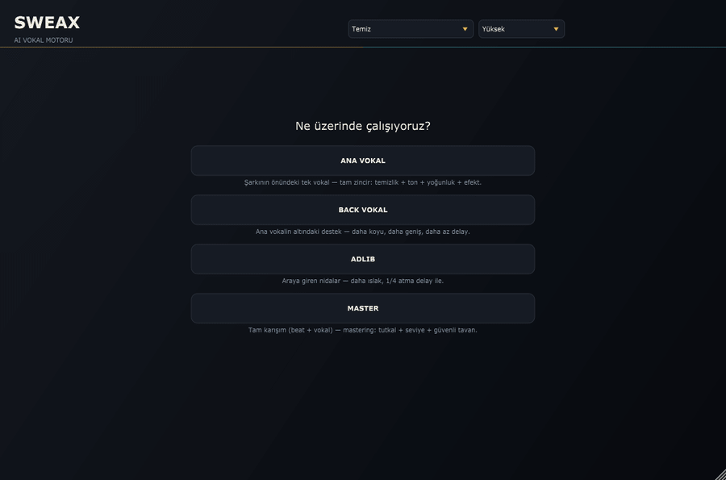

<sub>Demo kayıt eklentiden geçerken eklentinin kendisi tarafından, ekran dışında çizildi.</sub>

</div>

## Nedir

SweaxNext rap vokali için bir VST3 eklentisi. Vokal kanalına tak, kanalın ne olduğunu söyle (ana vokal, back, adlib
ya da bütün master), **VOKALİ ANALİZ ET**'e bas ve verse'ü çal. Dinler, her cümleyi ölçer ve neyin yanlış olduğunu
adıyla söyler: mikrofon patlamaları, sert s'ler, oda gürültüsü, şebeke vınlaması, farklı seviyede okunmuş satırlar,
kutu gibi ya da çamurlu ton. Sonra seçtiğin stile göre bir zincir kurar, bu zinciri duyduğu kaydın üstünde arka
planda işler, yeniden ölçer ve düzeltir. İş bitince her karar sıradan parametrelerde durur: okuyabilir,
değiştirebilir, otomasyon yazabilir, geri alabilirsin.

Sadece kaydın ihtiyacı olanı yapar. Kanıtı olmayan modül kapalı kalır ve kartında **GEREKMEDİ** yazar.

## Dinle

Demo vokal, bu depo için yazılmış satırları okuyan sentetik bir ses (Piper TTS, CC0 ses), sonra bilerek
bozuldu: kutu gibi oda, kısa yansıma, fan gürültüsü, 50 Hz vınlama, *p* ve *b*'de mikrofon patlamaları, 7 kHz
civarında sert s'ler ve aralarında 13 dB'e varan fark olan satırlar. Aşağıdaki her işlenmiş sürüm, eklentinin kendi
çevrimdışı render aracı `SweaxRender`'ın ana vokal rolüyle verdiği çıktı. Elle hiçbir şeye dokunulmadı.

<p align="center">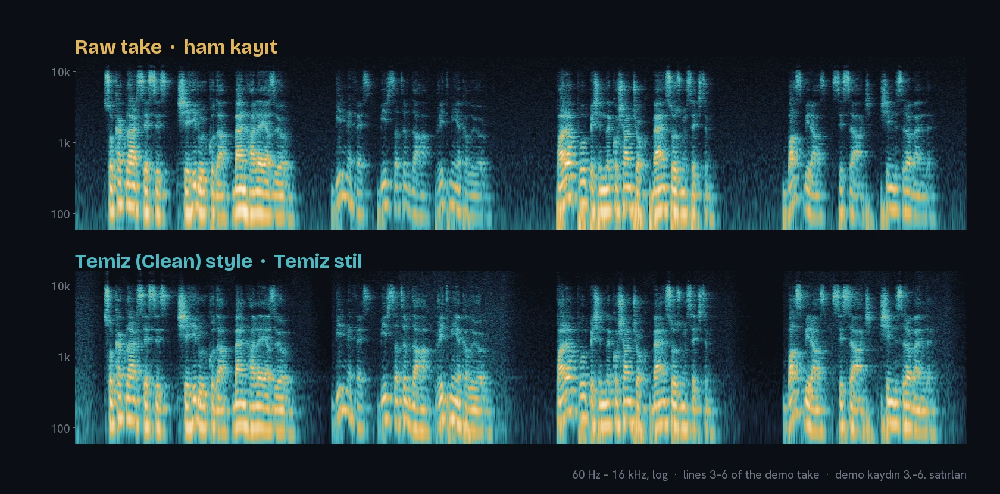</p>

**Dinle:** [ham kayıt](docs/audio/ham.mp3) · [Doğal](docs/audio/dogal.mp3) · [Temiz](docs/audio/temiz.mp3) ·
[Trap](docs/audio/trap.mp3) · [Agresif](docs/audio/agresif.mp3) · [Ezhel tarzı](docs/audio/ezhel.mp3) ·
[Killoki tarzı](docs/audio/killoki.mp3) · [Motive tarzı](docs/audio/motive.mp3) · [beat](docs/audio/beat.mp3) ·
ya da 16 stilin hepsi arasında A/B, eşit ses ve altında beat ile [sitede](https://sweax3169.github.io/sweaxnext/#listen)
canlı geçiş yap.

58 saniyelik kaydın tamamında **Temiz** stil ile değişenler:

| Ölçülen | Ham kayıt | SweaxNext'ten sonra | Nasıl ölçüldü |
|---|---:|---:|---|
| Yükseklik | −22,9 LUFS | −19,4 LUFS | integrated, ITU-R BS.1770, eklentinin kendi raporu |
| Gürültü tabanı | −54,6 dBFS | −67,2 dBFS | eklentinin kendi raporu |
| Sinyal / gürültü | 32,3 dB | 47,5 dB | eklentinin kendi raporu |
| Satır arası gürültü | −54,3 dBFS | −56,9 dBFS | 16 satır arasındaki boşlukların medyan RMS'i |
| En yüksek ve en kısık satır farkı | 12,4 dB | 3,6 dB | her satırın 100 Hz üstü RMS'i |
| Alçak darbe (patlama) | 15,2 dB | 9,5 dB | 20–120 Hz'in en yüksek 20 ms'i, vokal gövdesine göre |
| Sert s tepeleri | 10,7 dB | 5,9 dB | 5–10 kHz'in 99. yüzdeliği, vokal gövdesine göre |
| Bulunan patlama | 7 | 0 | eklentinin kendi dedektörü |

<sub>Her stil için aynı sayılar [`docs/audio/demo.json`](docs/audio/demo.json) içinde. `Tools/demo/demo_uret.py`,
`render_hepsi.py` ve `yayin_hazirla.py` ile yeniden üretilir.</sub>

## Ne yapar

<table>
<tr>
<td width="50%"><picture><source media="(prefers-color-scheme: dark)" srcset="docs/art/card-listen-dark-tr.svg"></picture></td>
<td width="50%"><picture><source media="(prefers-color-scheme: dark)" srcset="docs/art/card-diagnose-dark-tr.svg"></picture></td>
</tr>
<tr>
<td width="50%"><picture><source media="(prefers-color-scheme: dark)" srcset="docs/art/card-verify-dark-tr.svg"></picture></td>
<td width="50%"><picture><source media="(prefers-color-scheme: dark)" srcset="docs/art/card-styles-dark-tr.svg"></picture></td>
</tr>
<tr>
<td width="50%"><picture><source media="(prefers-color-scheme: dark)" srcset="docs/art/card-ab-dark-tr.svg"></picture></td>
<td width="50%"><picture><source media="(prefers-color-scheme: dark)" srcset="docs/art/card-realtime-dark-tr.svg"></picture></td>
</tr>
</table>

- **Önce dinler.** Sen kaydı çalarken vokali arka planda yakalar ve cümle cümle analiz eder: ses etkinliği, perde,
  yükseklik, true peak ve her karenin spektrumu. Ekran şu ana kadar ne duyduğunu ve ne kadar emin olduğunu gösterir.
  Kayıt uzadıkça güven artar; kanıt azsa daha az şey yapar.
- **Sorunu adıyla bulur.** Her biri olasılık, şiddet ve güven bildiren 22 kontrol: kırpılma, düşük seviye, DC kayması,
  gürültü tabanı, vınlama, hışırtı, alçak frekans gürültüsü, uğultu, yakınlık, çamur, kutu, genizden, sert, donuk,
  parlak, cılız, rezonanslar, cümleler arası seviye zıplaması, düzensiz heceler, aşırı sıkıştırma, sert s ve patlama.
- **Kendi işini ölçer.** Plan, yakalanan kaydın üstünde arka planda işlenir ve yeniden ölçülür. Sonuç hedefi
  tutturamazsa düzeltip tekrar dener, en çok üç tur, en iyisini tutar.
- **16 stil.** Her stil eksiksiz bir reçete: ekleme modüllerinin sırası ve her modülün başlangıç ayarı. Her modülün
  senin kaydında ne kadar çalışacağına yine analiz karar verir.
- **Eş seviyede A/B.** **ORİJİNAL** kuru kaydını gecikmesi hizalanmış ve işlenmişle aynı yükseklikte çalar
  (**A/B EŞİT SES**), yüksek olan iyi gibi gelip seni kandırmaz. **DELTA** yalnız eklentinin eklediğini ya da
  çıkardığını çalar.
- **Gerçek zamanlı.** Gecikme yalnız kalite moduna bağlıdır ve DAW'a bildirilir. Kayıtta **Canlı**, mixte **Yüksek**.

## Ekran

| | |
|---|---|
| 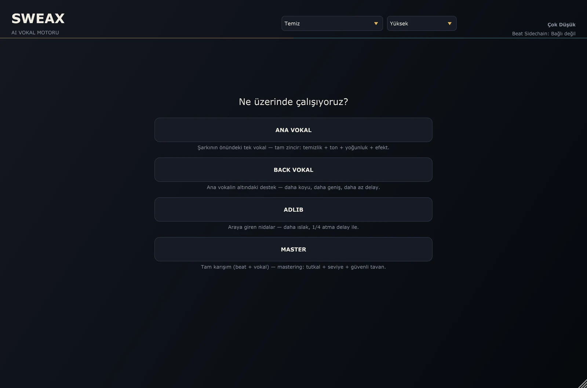 | 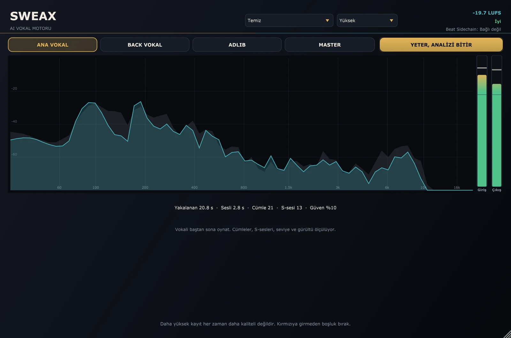 |
| **Rol seçimi.** *ANA VOKAL*, *BACK VOKAL*, *ADLIB* ya da *MASTER*. | **Dinliyor.** Sen çaldıkça cümleler, s sesleri ve patlamalar sayılır; güven yükselir. |
| 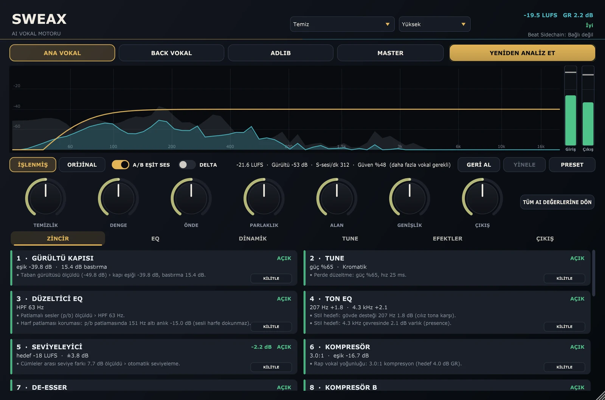 | 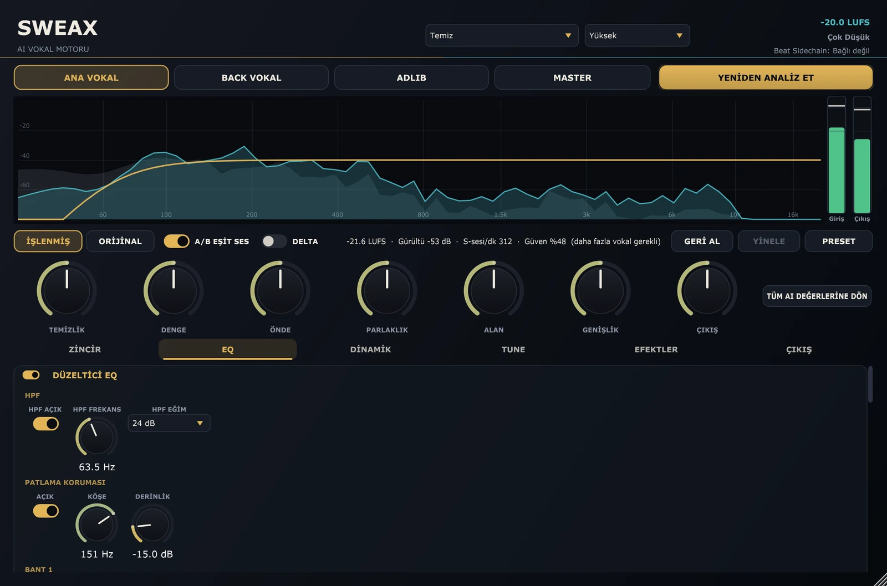 |
| **ZİNCİR.** İşlem sırasıyla kartlar; her biri ne yaptığını ve nedenini yazar. Yeniden analizde kendi ayarını korumak için kartı **KİLİTLE**, bir modülü zorla açmak için **YİNE DE AÇ**. | **EQ.** Yüksek geçiren filtre, filtreden önce çalışan patlama koruması, her biri dinamik olabilen altı bant ve stilin ton EQ'su. |
| 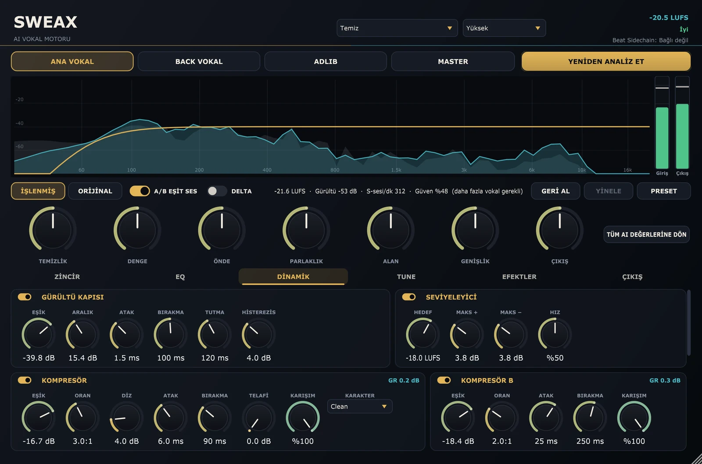 | 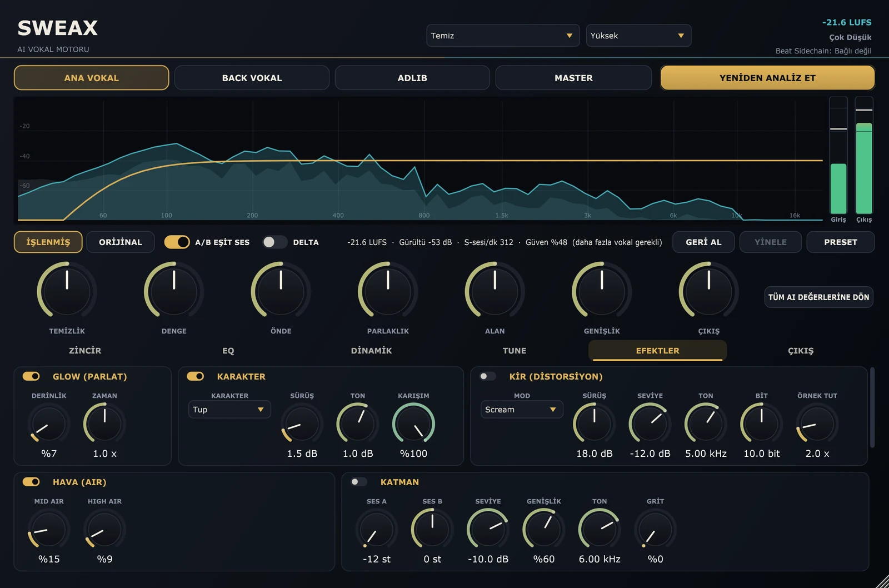 |
| **DİNAMİK.** Kapı, seviyeleyici, iki kompresör, son aşama s sigortalı de-esser ve anlık çınlayan rezonanslar için *YUMUŞAT*. | **EFEKTLER.** Glow, karakter doygunluğu, kir, hava, oktav katmanı, doubler, delay, reverb ve genişlik. |
| 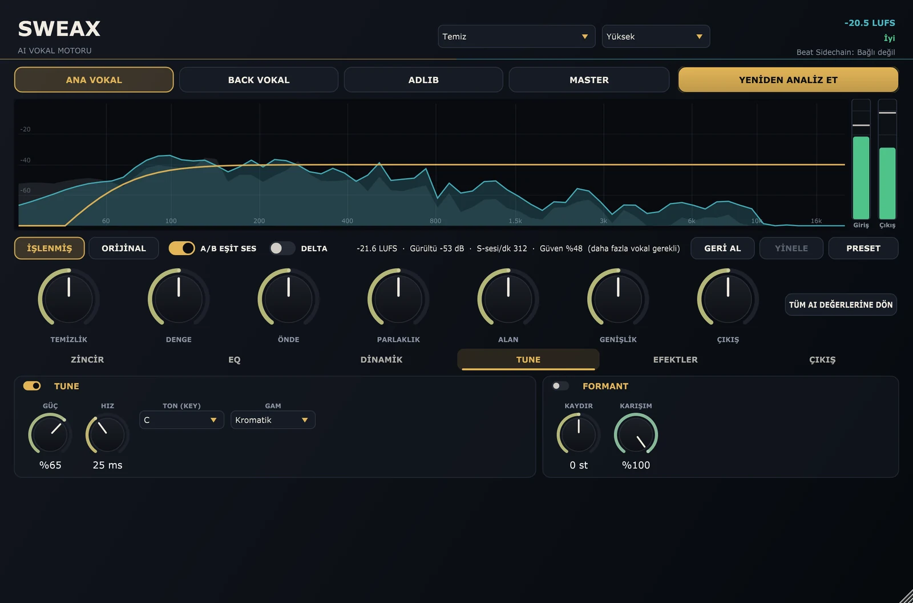 | 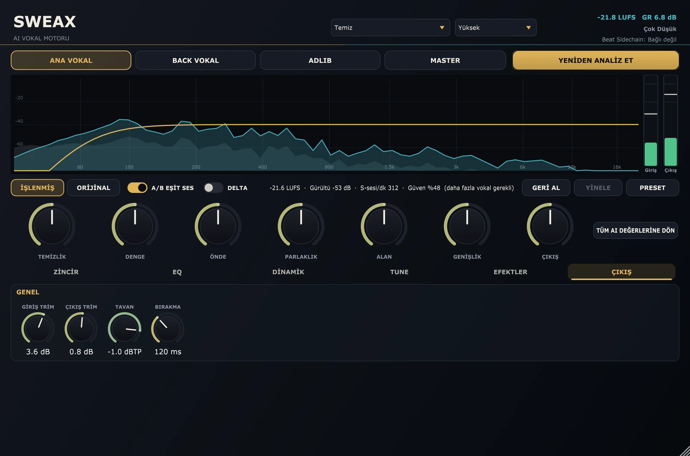 |
| **TUNE.** Gamı anlayabildiğinde gama kilitlenen perde düzeltme ve perdeye dokunmadan formant kaydırma. | **ÇIKIŞ.** Giriş ve çıkış trimi, true-peak tavanı ve limiter bırakma süresi. |

Spektrumun altındaki yedi makro birçok parametreyi birden çevirir: **TEMİZLİK**, **DENGE**, **ÖNDE**, **PARLAKLIK**,
**ALAN**, **GENİŞLİK** ve **ÇIKIŞ**. **TÜM AI DEĞERLERİNE DÖN** her şeyi analizin seçtiği değerlere geri getirir.

## 16 stil

<p align="center">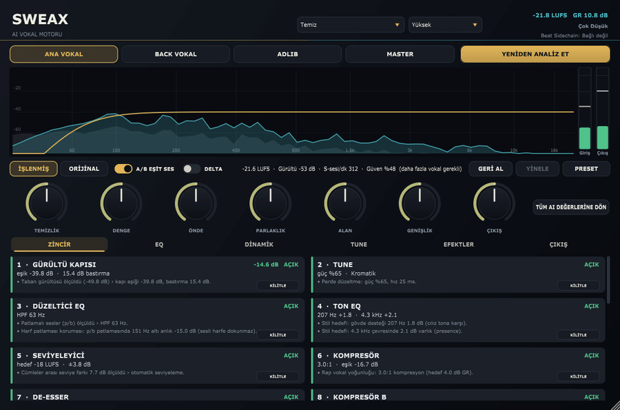</p>

Stili üstteki kutudan seç. Hazır bir mixte yeni plan yeniden dinlemeden hemen uygulanır.

| Stil | Reçete ne yapıyor |
|---|---|
| **Doğal** | Hafif dokunuş: tune yok, yumuşak 2.5:1 kompresyon, doubler ve delay yok, biraz plate. |
| **Temiz** | Net ve önde: presence ve hava kalkışı, yumuşak tune, hafif doubler, kısa slap ve plate. |
| **Trap** | Sert tune (4 ms), 4:1 kompresyon, doygunluk ve glow, iki sesli doubler, biraz daha geniş. |
| **Agresif** | Ağır 4:1 kompresyon ve sürüş, ikilenmiş, kısa reverb. |
| **Killoki tarzı** | Rage: 8:1 punch kompresyon, kırık doygunluk ve fuzz kiri, oktav üstü katman, koyu üst, noktalı sekizlik delay ve salon. |
| **Reçkol tarzı** | Parlak ve dolu: gövde ve hava kalkışı, bant doygunluğu, formant 1,6 yarım ton aşağı, geniş iki sesli doubler, chamber. |
| **Ati242 tarzı** | Koyu ve ılık: 165 Hz kalkışı, koyu üst, yumuşak dizli kompresyondan opto'ya, hafif scream kiri, 2 sn plate. |
| **Uzi tarzı** | İnce alt (190 Hz'den yüksek geçiren), hızlı 6:1 punch, bant doygunluğu, oktav altı ve beşli katman, dörtlük delay. |
| **Motive tarzı** | Ilık ve ıslak: glow, üstte hava, sekizlik delay, uzun chamber (2,9 sn) %28. |
| **Kava tarzı** | 750 Hz çukuru, opto kompresyon, alt-orta yumuşatma, doubler yok, kısa oda (0,45 sn). |
| **Ezhel tarzı** | Melodik: çok hızlı tune (1,8 ms), formant aşağı, hafif kompresyon, havadar üst, oktav üstü katman, ikilenmiş, noktalı sekizlik yankı. |
| **Ceza tarzı** | Anlaşılır ve yakın: neredeyse tune yok, 540 Hz kesimi, vuruşlu 4:1, presence yumuşatma, kısa slap, dar oda (0,35 sn). |
| **Allame tarzı** | Doğal ve kuru: tune yok, doygunluk yok, doubler ve delay yok, yumuşak kompresyon, küçük oda. |
| **Şehinşah tarzı** | Sert tune (2,5 ms), 5:1 punch, formant yukarı, oktav üstü katman, ikilenmiş, onaltılık delay, chamber. |
| **Sagopa Kajmer tarzı** | Koyu ve derin: üst raf 4 dB aşağı, yavaş opto kompresyon, geniş oktav üstü katman ve doubler, küçük oda. |
| **Ben Fero tarzı** | En sert tune (1 ms), presence +4 dB, zincirin başında doygunluk ve kir, 4.5:1 punch, kısa plate. |

> [!NOTE]
> On iki sanatçı stili (*… tarzı*), o sanatçıların yayımlanmış kayıtlarında duyulan vokal sound'unun yazılı
> tarifinin işleme reçetesine dönüştürülmüş hâlidir. Sanatçıların kendi ayarları değildir. Killoki, Reçkol, Ati242,
> Uzi, Motive, Kava, Ezhel, Ceza, Allame, Şehinşah, Sagopa Kajmer ve Ben Fero ile plak şirketlerinin ve
> mühendislerinin SweaxNext ile bağlantısı ya da onayı yoktur. Adlar yalnız bir sound'u tarif etmek için kullanılır.

## Sinyal zinciri

<picture>
  <source media="(prefers-color-scheme: dark)" srcset="docs/art/chain-dark-tr.svg">
  
</picture>

Kapı her zaman başta. Doubler, delay, reverb ve genişlik kuyruğu, çıkış trimi ve true-peak limiter her zaman sonda.
Aradaki on beş ekleme aşamasının sırasını stil belirler.

| Modül | Ekranda | Ne yapar |
|---|---|---|
| Kapı | GÜRÜLTÜ KAPISI | Cümle aralarındaki oda sesini kesmek yerine sınırlı bir aralıkta bastırır, nefesler doğal kalır. |
| Tune | TUNE | Gerçek zamanlı perde düzeltme; gamdan eminse gama kilitlenir, değilse kromatik. |
| Formant | FORMANT | Perdeyi değiştirmeden formantları yukarı ya da aşağı taşır. |
| Düzeltici EQ | DÜZELTİCİ EQ | Yüksek geçiren, filtreden önce patlama koruması, altı bant (çan, raflar, çentik), her biri istenirse dinamik. |
| Ton EQ | TON EQ | Stilin ton eğrisi, düzeltici EQ'dan ayrı. |
| Seviyeleyici | SEVİYELEYİCİ | Gürültüyü yükseltmeden cümleden cümleye seviyeyi eşitler; aralarda donar. |
| Kompresör A | KOMPRESÖR | Clean, smooth, punch ya da opto karakter; peak, RMS ya da hibrit dedektör; ileriye bakış. |
| De-esser | DE-ESSER | Bölünmüş bant ya da geniş; parlak sesli harflere dokunmaz; zincir sonundaki s sigortası vokal gövdesine göre çalışır. |
| Yumuşat | YUMUŞAT | Anlık çınlayan rezonansları harmoniklere dokunmadan spektral olarak bastırır. |
| Kompresör B | KOMPRESÖR B | Yapıştırma için ikinci, daha yavaş aşama. |
| Glow | GLOW (PARLAT) | Yoğunluk için üç bantlı yukarı ve aşağı kompresyon. |
| Karakter | KARAKTER | Tüp, bant ya da kırık doygunluk, 2× oversample. |
| Kir | KİR (DİSTORSİYON) | Ana vokalin altına karışan paralel scream, fuzz ya da lo-fi yolu. |
| Hava | HAVA (AIR) | Programa bağlı üst kaldırma; zaten parlak kayda dokunmaz. |
| Katman | KATMAN | En çok iki perde kaydırılmış paralel ses (oktav, beşli). |
| Doubler | DOUBLER | Sağa sola yayılan iki ya da dört mikro-detune kopya. |
| Delay | DELAY | Slap ya da tempoya bağlı ping-pong, bant sınırlı, sen okurken kısılır. |
| Reverb | REVERB | Plate, oda, salon ya da chamber; vokalin altında kısılır. |
| Genişlik | GENİŞLİK | Mono uyumlu orta/yan genişlik. |
| Limiter | GÜVENLİK LİMİTER | True-peak ileriye bakışlı limiter, Yüksek ve Ultra'da 4× oversample. |

## Nasıl karar verir

<picture>
  <source media="(prefers-color-scheme: dark)" srcset="docs/art/architecture-dark-tr.svg">
  
</picture>

İçinde sinir ağı yok. Buradaki "AI", adım adım izlenebilen bir ölçme ve plan kurma motoru:

1. **Ölç** (`Source/Analysis`). Ses iş parçacığı girişi kilitsiz bir FIFO'ya kopyalar, başka hiçbir şey yapmaz. Arka
   plandaki iş parçacığı onu yakalama deposuna taşır ve parça parça analiz eder: STFT özellikleri, ses etkinliği,
   perde, K-ağırlıklı yükseklik, true peak, cümleler, s sesleri, patlamalar ve nefesler.
2. **Teşhis** (`Source/Decision/Detectors`). Her sorun türü için bir kontrol; her biri olasılık, şiddet ve güven döndürür.
3. **Karar** (`Source/Decision/Planner`). Stil reçetesi (`Receteler.h`) zincir sırasını ve her modülün başlangıcını
   verir; bulgular onu şiddet × güven ölçeğinde, korkuluklar içinde oynatır.
4. **Doğrula** (`Source/Decision/Feedback`, `Sandbox`). Plan, yakalanan kayıtta birebir aynı zincirle, gecikmesi
   telafi edilerek arka planda işlenir, yeniden ölçülür ve en çok üç turda düzeltilir.
5. **Yayınla** (`Source/Decision/PlanPublisher`). Mesaj iş parçacığında plan eklentinin parametrelerine tek bir geri
   alınabilir adım olarak yazılır. Ses iş parçacığı yalnız bir parametre önbelleğini okur; asla beklemez, kilitlemez,
   bellek ayırmaz. Makrolar ayrı parametrelerdir, modül değerleriyle ses iş parçacığında birleşir.

Gecikme yalnız örnekleme hızına ve kalite moduna bağlıdır; modül açıp kapamak onu asla değiştirmez.

## Kurulum

1. [Son sürümden](https://github.com/Sweax3169/sweaxnext/releases/latest) **SweaxNext-1.0.0-Setup.exe**'yi indir ve
   çalıştır. Yönetici izni istemeden yalnız senin için `%LOCALAPPDATA%\Programs\Common\VST3` klasörüne kurar. İlk
   pencerede *tüm kullanıcılar* seçersen `C:\Program Files\Common Files\VST3` kullanılır. Kurulum dosyası kod
   imzalı değil; SmartScreen önce sorabilir (*Ek bilgi* → *Yine de çalıştır*).
2. Kurulum istemiyor musun? **SweaxNext-1.0.0-win64-vst3.zip**'i aç ve `SWEAX NEXT.vst3` klasörünü bu klasörlerden
   birine kendin kopyala.
3. İstersen indirdiğini `SHA256SUMS.txt` ile karşılaştır: `certutil -hashfile SweaxNext-1.0.0-Setup.exe SHA256`.

Gereken: Windows 10 ya da 11, 64 bit ve VST3 açabilen bir DAW.

### Studio One

1. **Studio One → Options → Locations → VST Plug-Ins**'i aç. Eklentinin kurulduğu klasör listede yoksa ekle.
   **Reset Blocklist**'e bas, pencereyi kapat ve Studio One'ı yeniden başlat.
2. **Browse → Effects** panelinde **SWEAX NEXT**'i *Sweax Studios* altında bul ve vokal kanalına ilk insert olarak
   sürükle. Dinlerken o kanaldaki diğer insert'leri bypass et.
3. Rolü seç, **VOKALİ ANALİZ ET**'e bas ve verse'ün tamamını çal (otuz saniye ya da daha uzun kuru vokal en iyisi).
   **YETER, ANALİZİ BİTİR**'e bas.
4. **ORİJİNAL / İŞLENMİŞ** ile karşılaştır, stili değiştir, makroları oynat. Her şey geri alma listesine girer
   (**GERİ AL / YİNELE**). Ayarı **PRESET** ile kaydet.

Kayıt alırken üstteki kalite kutusunu **Canlı** yap. Mixe geçince **Yüksek**'e dön; Studio One bildirilen gecikmeyi
telafi eder.

FL Studio, Ableton Live, Cubase ve REAPER eklenti taramasından sonra aynı klasörlerden bulur.

## Gecikme ve işlemci

| Kalite modu | 44,1 kHz | 48 kHz | 96 kHz |
|---|---:|---:|---:|
| Canlı | 41,3 ms | 39,4 ms | 39,1 ms |
| Yüksek | 237,8 ms | 234,0 ms | 233,6 ms |
| Ultra | 237,8 ms | 234,0 ms | 233,6 ms |

Kapı, tune, EQ, seviyeleyici, iki kompresör, de-esser, doygunluk, doubler, delay, reverb ve genişlik açıkken zincir
Yüksek kalitede tek bir işlemci çekirdeğinin %8–15'ini kullandı (48 kHz stereo, 256 örneklik blok, AMD Ryzen 5 7600,
altı ölçüm). Sayılar `SweaxShots --bilgi` ve `zincir_rt_butcesi` testinden.

## Kaynaktan derleme

Visual Studio 2022 (Desktop C++), CMake 3.22 ya da üstü ve Git gerekir. JUCE 7.0.12 ilk configure'da indirilir;
elindeki bir kopyayı kullanmak için `-DJUCE_DIR=<yol>` ver. MSBuild çok uzun yollarda hâlâ takıldığı için depoyu
`C:\src` gibi kısa bir yola klonla.

```bash
git clone https://github.com/Sweax3169/sweaxnext.git
cd sweaxnext
cmake -G "Visual Studio 17 2022" -A x64 -B build
cmake --build build --config Release --target SweaxNext_VST3 SweaxTests SweaxRender SweaxShots
build\SweaxTests_artefacts\Release\SweaxTests.exe
```

VST3 `build\SweaxNext_artefacts\Release\VST3\SWEAX NEXT.vst3` içine çıkar; `Tools\kur.cmd` onu kullanıcı VST3
klasörüne kopyalar. `Tools\derle.cmd Release SweaxNext_VST3` configure ve derlemeyi tek seferde yapar.

| Hedef | Nedir |
|---|---|
| `SweaxNext_VST3`, `SweaxNext_Standalone` | eklenti |
| `SweaxTests` | kendi küçük çalıştırıcısıyla 159 test (`SweaxTests <ad süzgeci>`, `SWX_VERBOSE=1` ölçümleri yazar) |
| `SweaxRender` | `SweaxRender giris.wav cikis.wav rapor.json --rol ana --stil temiz`: çevrimdışı analiz, plan ve render, JSON raporla |
| `SweaxShots` | editörü ekran dışında PNG'lere ve kayıpsız videoya çizer (bu sayfadaki görseller); `--bilgi` gecikmeleri yazar |

Her sürüm [pluginval](https://github.com/Tracktion/pluginval) ile strictness 10'da kontrol edilir:
`pluginval --strictness-level 10 --validate "SWEAX NEXT.vst3"`. GitHub Actions her push'u derler, test eder ve
paketler; etiketli sürümlere kurulum dosyasını, zip'i ve sağlama toplamlarını ekler.

### Proje yapısı

```text
Source/
  Core/         parametre tablosu, parametre önbelleği, kilitsiz FIFO, yumuşatıcılar, gerçek zamanlı tahsis bekçisi
  Analysis/     yakalama deposu, STFT özellikleri, VAD, perde, yükseklik, çevrimdışı rapor, analiz iş parçacığı
  Decision/     dedektörler, planlayıcı, stil reçeteleri, çevrimdışı sandbox, geri besleme, plan yayıncısı
  DSP/          20 modül ve paylaştıkları spektral motor
  Chain/        vokal zinciri ve stile göre ekleme sırası
  State/        oturum durumu (rol, stil, kilitler, plan), parametrelerden ayrı
  UI/           görünüm, spektrum, metreler, modül kartları ve şeritleri, Türkçe metinler
  PluginProcessor.*, PluginEditor.*
Tests/          159 test: DSP, analiz, karar, entegrasyon, editör
Tools/
  SweaxRender/  çevrimdışı render        SweaxShots/  ekran dışı editör çizici
  demo/         demo vokal, render'lar ve bu sayfadaki sayılar
  art/          bu sayfadaki hareketli SVG'ler
  installer/    Inno Setup betiği
docs/           GitHub Pages sitesi, medya, ses, çizimler, sürüm notları
```

## Sorular

**Sesim bilgisayardan çıkıyor mu?** Hayır. Eklentide ağ kodu yok; JUCE ağ özellikleri kapalı derleniyor. Analiz senin
bilgisayarında, arka planda çalışır.

**Neden vokali çalmamı istiyor?** Kanıta bakarak karar verir. Kısa kayıtta güveni düşüktür ve daha az şey yapar.
Diğer efektlerin bypass'ta, otuz saniye ya da daha uzun kuru vokal en iyi planı verir.

**Kendi ayarlarımı koruyabilir miyim?** Modül kartını kilitle. Yeni analiz kilitli modüllere dokunmaz ve her
değişiklik geri alınabilir.

**Mac ya da Linux?** Henüz değil. Kod düz JUCE ve CMake ama yalnız Windows derleniyor ve deneniyor.

**Neden sanatçı adları?** Herkesin bildiği bir sound'u anlatmanın en kısa dürüst yolu. [16 stil](#16-stil) altındaki
nota bak.

## Lisans

SweaxNext [GNU Genel Kamu Lisansı v3](LICENSE) altında özgür yazılımdır. JUCE'un GPLv3 seçeneğiyle
[JUCE 7](https://juce.com) ve GPLv3 seçeneğiyle Steinberg VST3 SDK kullanılarak yapıldı; bkz.
[THIRD_PARTY_NOTICES.md](THIRD_PARTY_NOTICES.md). VST, Steinberg Media Technologies GmbH'nin tescilli markasıdır.

[Sweax Studios](https://github.com/Sweax3169) yapımı.
